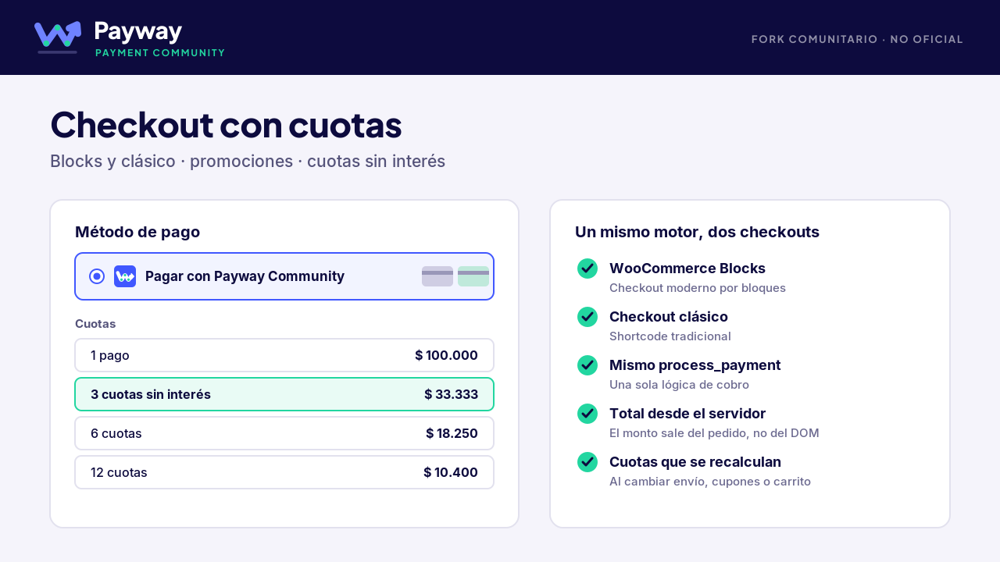
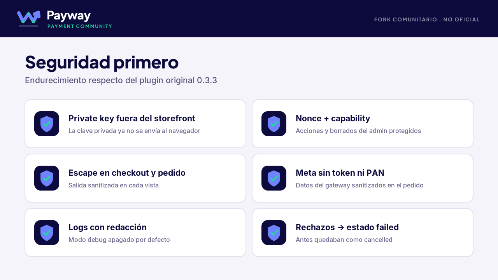
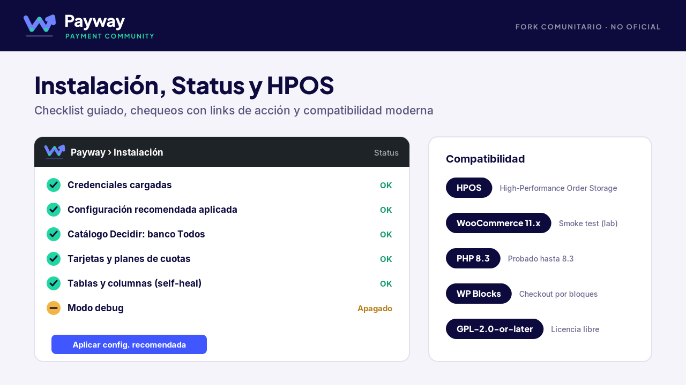

# Payway Payment Community

  <picture>
    <source media="(prefers-color-scheme: dark)" srcset="assets/github/readme-banner-oscuro.png">
    <source media="(prefers-color-scheme: light)" srcset="assets/github/readme-banner-claro.png">
    
  </picture>

  

Gateway de pago para WooCommerce basado en Payway/Decidir. Es un **fork independiente**, no un producto oficial de Payway.

> No está desarrollado, respaldado ni soportado por Payway. El mantenimiento corre por cuenta de Alan Martinez ([alanjmrt94](https://github.com/alanjmrt94)).

**Versión actual:** **2.0.5** — header `Version:` en [`wc-gateway-payway/index.php`](wc-gateway-payway/index.php) · detalle en [`CHANGELOG.md`](CHANGELOG.md) · tag local `v2.0.5` (SDK PHP **2.0.10**, montos en centavos).

Partió del plugin original [payway-ar/plugin-woocommerce](https://github.com/payway-ar/plugin-woocommerce) **0.3.3** y lo mantiene como fork Community (misma carpeta `wc-gateway-payway` y tablas `prisma_payway_*` para migrar sin perder datos).

## Destacados

### Checkout y montos

- **WooCommerce Blocks** + checkout clásico (mismo `process_payment`).
- El total cobrado sale del **pedido en servidor**, no del DOM ([#64](https://github.com/payway-ar/plugin-woocommerce/issues/64)).
- Cuotas clásicas se **refrescan** al cambiar envío/cupones (`updated_checkout`); en Blocks se recalculan si cambia el carrito.
- `validate_fields()` real + validación en servidor de promo / plan / tarjeta / banco.

### Seguridad y robustez

- La **private key** ya no se envía al storefront.
- Deletes admin con nonce + capability; escape en checkout y pedido.
- Meta del gateway sanitizada (sin token/PAN); logs debug con redacción (apagado por defecto).
- Pedidos rechazados → estado `failed` (antes `cancelled`).
- Schema **self-heal** (tablas/columnas, promos sin FK frágiles, `no_expiry`).

### Admin y puesta en marcha

- Menú **Setup → Banks → Cards → Promotions → Recent Payments → Status**.
- **Payway → Instalación**: checklist + «Aplicar config. recomendada» + seed de catálogo Decidir.
- Panel **Recent Payments** (`PaymentList`) con link al pedido WooCommerce.
- Settings WC agrupados (General / Sandbox / Production) + notices si faltan keys/promos.
- Promociones con **Sin vencimiento** (`no_expiry`).
- Compatible con **HPOS** (ver [`docs/manual/08-hpos.md`](docs/manual/08-hpos.md)); lab smoke WP/WC hasta **11.x** / PHP 8.3.

### i18n y packaging

- Strings en inglés; locales `es*` cargan `es_AR`.
- ZIP de release con carpeta raíz correcta (`wc-gateway-payway`) → `ci/dist/`.
- Licencia **GPL-2.0-or-later** completa + docs de matriz / manual.

Detalle versión a versión: [`CHANGELOG.md`](CHANGELOG.md).

## Manual (PDF)

Manuales oficiales en [`docs/`](docs/):

- Español: [`docs/payway-woo-v2-manual-es.pdf`](docs/payway-woo-v2-manual-es.pdf)
- English: [`docs/payway-woo-v2-manual-en.pdf`](docs/payway-woo-v2-manual-en.pdf)

Fuente Markdown: [`docs/manual/`](docs/manual/) (ES) · [`docs/manual/en/`](docs/manual/en/) (EN). Regenerar: `cd ci && npm run build:manual-pdfs`.

## Instalación rápida

1. Descargá el ZIP de [Releases](https://github.com/alanjmrt94/payway-woocommerce-v2/releases) (carpeta `wc-gateway-payway` en la raíz).
2. **Plugins → Añadir nuevo → Subir plugin**, o copiá la carpeta a `wp-content/plugins/`.
3. Activá **Payway Payment Community**.
4. **WooCommerce → Ajustes → Pagos → Payway Payment Community**: Enabled + claves.
5. **Payway → Instalación**: checklist y defaults (banco Todos, tarjetas, promociones).

Más detalle: [`wc-gateway-payway/README.md`](wc-gateway-payway/README.md) · docs: [`docs/README.md`](docs/README.md) · manual: [`docs/manual/`](docs/manual/).

## Brand / assets

Isotipo Community, favicon y banners GitHub viven en [`assets/`](assets/). Kit WordPress.org: [`docs/wordpress-org/`](docs/wordpress-org/).

Portada social de GitHub (subir a mano en **Settings → General → Social preview**): [`assets/github/social-preview-1280x640.png`](assets/github/social-preview-1280x640.png).

## Licencia

[GPL-2.0-or-later](https://www.gnu.org/licenses/old-licenses/gpl-2.0.html) — texto en [`LICENSE`](LICENSE), notas en [`docs/license.md`](docs/license.md).

Copyright (C) 2026 Alan Martinez ([alanjmrt94](https://github.com/alanjmrt94)).  
Basado en trabajo previo de IURCO / Prisma SA ([payway-ar/plugin-woocommerce](https://github.com/payway-ar/plugin-woocommerce)).
