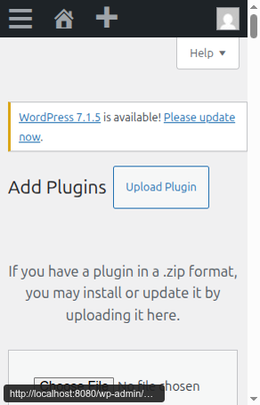
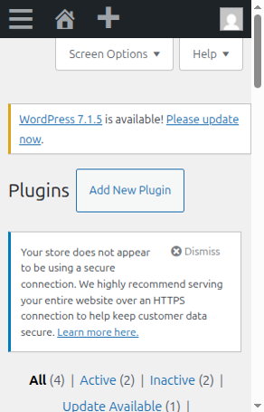
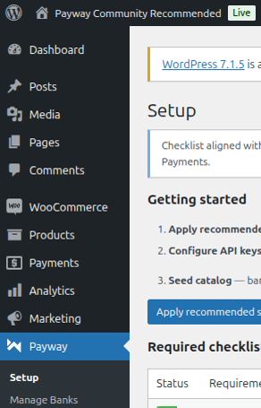

# 4. Instalación

## Descargar el ZIP

1. Obtené el ZIP desde [GitHub Releases](https://github.com/alanjmrt94/payway-woocommerce-v2/releases) (versión **2.0.0** o superior).
2. Al descomprimir, la carpeta raíz debe ser **`wc-gateway-payway`** (un solo nivel; no un zip dentro de otro zip ni una carpeta `payway-woocommerce-v2`).

## Vía Administrador de WordPress

1. Entrá al panel de Administración.
2. **Plugins → Añadir nuevo → Subir plugin**.
3. Seleccioná el `.zip` y **Instalar ahora**.
4. **Activar** el plugin **Payway Payment Community**.

## Copia manual

1. Descomprimí el ZIP.
2. Copiá la carpeta `wc-gateway-payway` a `wp-content/plugins/`.
3. En **Plugins → Plugins instalados**, activá **Payway Payment Community**.

## Después de activar

El menú lateral **Payway** (locale español) sigue este orden:

**Instalación → Bancos → Tarjetas → Promociones → Últimos pagos → Estado**

(En inglés: Setup → Banks → Cards → Promotions → Recent Payments → Status.)

### Orden recomendado de puesta en marcha

1. **Payway → Instalación → Aplicar config. recomendada**  
   Deja Enabled, Sandbox, Cybersource, Debug, título/descripción y **decimales = 2**.
2. **WooCommerce → Ajustes → Pagos → Payway Payment Community**  
   Cargá Site Id / Public Key / Private Key del ambiente. Ver [05 — Configuración](05-configuracion.md).
3. En **Instalación**: seed del catálogo (banco «Todos», tarjetas y promociones default) o alta manual. Ver [06 — Bancos, tarjetas y promociones](06-bancos-tarjetas-promociones.md).
4. Moneda de la tienda: **ARS** o **USD**.
5. Checkout **clásico** o **Blocks** (ambos soportados).

Si el medio no aparece en el checkout, abrí **Payway → Estado** y [09 — Diagnóstico](09-diagnostico.md).

## Errores frecuentes al instalar

| Síntoma | Qué revisar |
|---|---|
| Medio oculto en checkout | Enabled + keys del ambiente + al menos una promo aplicable (seed en Instalación) |
| Débito rechaza o no ofrece 1 cuota | Cada tarjeta de débito necesita un plan con `fee_to_send` = 1 |
| Aviso de moneda | Solo ARS/USD; Estado marca moneda no soportada |
| Compat Woo / Blocks | WC ≥ 6.0; Blocks necesita API de payment methods (Estado → Checkout surface) |
| CS / 10734 | Comercio exige Fraud Detection → Cybersource ON; ver [05](05-configuracion.md) y [12 FAQ](12-faq.md) |

Tras activar, el admin puede redirigirte a **Payway → Instalación** para el checklist.

## WooCommerce como dependencia

El plugin declara `Requires Plugins: woocommerce`. Si WooCommerce no está instalado, instalalo y activalo antes (o junto) con Payway Payment Community.

## Entorno de pruebas

Todas las instalaciones de WordPress varían (tema, caché, otros plugins). Probá primero en un clon o staging fiel al sitio real antes de producción.
