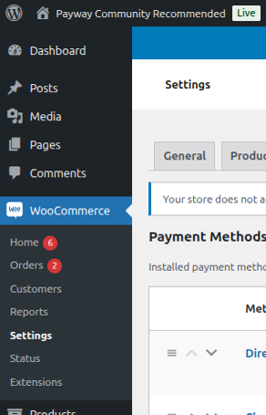
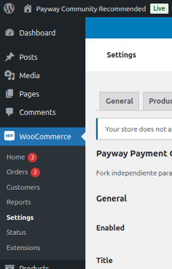

# 5. Configuración (Pagos / Sandbox / Producción)

Configurar bancos y promociones en el menú **Payway** no alcanza: el método de pago se activa en WooCommerce.

## Paso a paso

1. Andá a **WooCommerce → Ajustes → Pagos**.
2. Buscá **Payway Payment Community** (`payway_gateway`) y entrá a **Gestionar** / su pantalla de settings.
3. Marcá **Enabled** (activado).
4. Completá **Título** y **Descripción** (texto visible en el checkout). El default Community es título **Checkout Payway**.
5. Elegí el ambiente:
   - **Sandbox Mode** activado → usá Site Id / Public / Private de **prueba** (sección *Sandbox credentials*).
   - Sandbox desactivado → usá las claves de **Producción** (*Production credentials*).
6. Revisá **Cybersource** (antifraude) y **Debug Mode** (logs redactados; **apagado en producción** salvo diagnóstico puntual).
7. **Guardar los cambios**.

Sin **Enabled** y sin las tres claves del ambiente activo, el medio no opera. Este plugin **no** genera ni regenera keys.

También obligatorio: **WooCommerce → Ajustes → General → Número de decimales = 2**.

<!-- captura: assets/10-decimals-2.png -->

Desde **Payway → Instalación** podés usar **Aplicar config. recomendada** (Enabled, Sandbox, Cybersource, Debug, título/descripción, decimales=2; migra títulos legacy tipo `Credit Card` / `keep-me`) sin tocar las keys.

Si el gateway está **Enabled** y faltan keys o promociones aplicables, verás avisos **error** en el escritorio WP, en Pagos y en el menú Payway. Un Site Id = un comercio: no hay multi-site padre/hijo en este plugin.

### Cybersource y 10734

Si el sitio Payway exige Fraud Detection, dejar Cybersource **off** puede fallar con código **10734**. No es un problema de montos (SDK V2 usa centavos). Dejá CS alineado al comercio.

## Campos principales

| Campo | Uso |
|---|---|
| Enabled | Activa/desactiva el medio en el checkout |
| Título / Descripción | Texto mostrado al comprador |
| Modo Sandbox | Ambiente de prueba vs producción |
| Cybersource | Antifraude; en algunos comercios sandbox es obligatorio |
| Debug | Logs detallados con redacción de secretos |
| Site Id / Public Key / Private Key | Credenciales por ambiente |

Las settings están agrupadas en secciones **General / Sandbox / Production** en la UI admin.

## Dónde sacar las claves

Portal de desarrolladores / backoffice Payway del comercio (o el mail de alta). Sandbox y Producción usan claves distintas. Si no las tenés, pedilas a tu contacto comercial o mesa de Payway — **no** al autor del fork Community, que no emite keys.

## Desactivar sin perder datos

En **WooCommerce → Ajustes → Pagos**, desmarcá **Enabled**. Los compradores dejan de ver el medio; bancos, promos y keys siguen guardados.

## Últimos pagos

Para listar operaciones recientes en Decidir/Payway desde WP: **Payway → Últimos pagos** (requiere Private Key del ambiente activo). Ver [09 — Diagnóstico](09-diagnostico.md).
