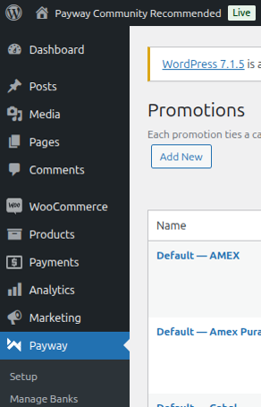

# 6. Bancos, tarjetas, promociones y cuotas

Desde el menú lateral **Payway** cargá las tarjetas y bancos que vas a usar y generá al menos una promoción **activa y aplicable** para que el método de pago se vea en el checkout.

También podés usar **Payway → Instalación** para crear el banco «Todos», seleccionar tarjetas del catálogo Decidir y generar promociones por defecto (incluye opción MiPyME 3→13 / 6→16).

## Bancos

Si no necesitás una promoción por banco puntual, agrupá todo en **Todos** (o «Todos los bancos»). Ese banco es el que suele usarse al armar la promoción.

CRUD: listar / añadir / editar / eliminar (con nonce y capability `manage_woocommerce`).

## Tarjetas

Cada tarjeta tiene `id_sps` (= `payment_method_id` enviado a Decidir) e `id_nps`. Catálogo habitual:

| Tarjeta | ID SPS | ID NPS |
|---|---|---|
| Visa Crédito | 1 | 1 |
| Visa Débito | 31 | 31 |
| Visa Prepaga | 114 | 114 |
| MasterCard Crédito | 104 | 104 |
| MasterCard Débito | 105 | 105 |
| MasterCard Prepaga | 116 | 116 |
| Maestro | 106 | 106 |
| Cabal Crédito | 63 | 63 |
| Cabal Débito | 108 | 108 |
| AMEX | 111 | 111 |
| Amex Pura | 65 | 65 |
| Discover | 139 | 139 |
| Naranja | 24 | 24 |
| Tarjeta Sol | 143 | 143 |

Nota: Amex Pura (`65`) suele aplicarse en Decidir 2.0, no en Ventas Online / D+.

## Promociones

Configurá **una promoción por tipo de tarjeta** (Visa Débito, Visa Crédito, Amex, etc.). En la mayoría de los comercios esto define los **planes de cuotas del checkout**, no una promo bancaria real del emisor.

Debe estar **activa** y ser **aplicable** el día del cobro.

### Sin vencimiento

Checkbox **Sin vencimiento** (`no_expiry`, activo por defecto en defaults): no se valida fecha de fin. Si lo desmarcás, cargá `to_date`.

Sin al menos una promoción aplicable, el medio **no aparece** en el checkout.

### Valores de cuotas comunes (`fee_to_send`)

| Cobro | Valor a enviar |
|---|---|
| 1 cuota | 1 |
| 3 cuotas | 3 |
| 6 cuotas | 6 |
| 12 cuotas | 12 |
| Cuota Simple 3 (MiPyME) | 13 |
| Cuota Simple 6 (MiPyME) | 16 |

Ejemplo crédito:

- Tarjeta = Visa Crédito · Banco = Todos  
- Periodo = 3 · Coeficiente = 1 · TEA = 0 · CFT = 0 · Valor a enviar = 3  

Ejemplo débito / 1 pago (también obligatorio tener promoción):

- Tarjeta = Visa Débito · Banco = Todos  
- Periodo = 1 · Coeficiente = 1 · Valor a enviar = 1  

Los defaults de Instalación crean planes 1/3/6/12 para créditos y solo plan 1 para débitos/prepagas/Maestro, con **Sin vencimiento** activo.

## Consideraciones

- Coeficiente &lt; 1 (descuentos): validá con tu esquema comercial; el plugin modela fee plans.
- Un solo Site Id: las promos de distintos bancos/establecimientos no se “resuelven” con varios Site Id en esta versión.
- Tras crear o editar promos, si el medio seguía oculto, revisá **Estado** y avisos de Instalación.
