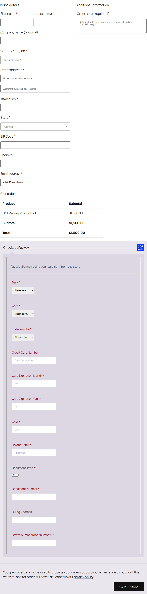
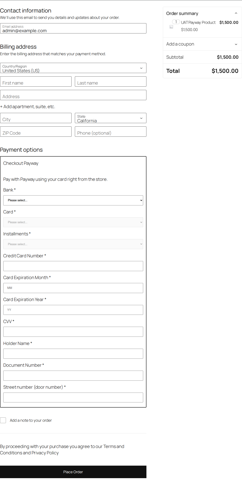
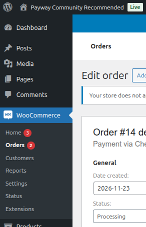

# 7. Checkout (clásico y Blocks) y pedidos

## Flujo de pago

1. El comprador elige banco / tarjeta / plan de cuotas en el formulario Payway.
2. **Tokenización** en el navegador con Decidir JS (hosts frontend Payway/Decidir). El servidor recibe un **token**, no PAN ni CVV.
3. El plugin valida en servidor promoción, plan, tarjeta/banco y arma el request.
4. El **importe** enviado a Payway sale del total del **pedido WooCommerce** (no del DOM del checkout).
5. Con SDK PHP **V2.0.10**, `amount` y `purchase_totals.amount` van en **centavos**.

## Checkout clásico

- Formulario embebido en el shortcode `[woocommerce_checkout]`.
- Al cambiar envío o cupones (`updated_checkout`), se refresca el total usado para armar el display de cuotas.
- Tokenización enganchada al place order del gateway (`checkout_place_order_payway_gateway`).

## WooCommerce Blocks

- Se registra como payment method cuando existen `AbstractPaymentMethodType` / `wc.wcBlocksRegistry`.
- Mismo `process_payment` que el checkout clásico.
- Si cambia el total del carrito, se limpian/recalculan las cuotas seleccionadas.

## Pedidos

| Situación | Comportamiento |
|---|---|
| Aprobado | Pedido pagado; meta Payway (IDs, promo, etc.) |
| Rechazado | Estado **`failed`** (no `cancelled`) |
| Mensaje al comprador | Tipado cuando hay `status_details.error.type` (ej. `invalid_card`) |
| Idempotencia | `site_transaction_id` estable `payway-{order_id}` + lock corto en `process_payment` |

En el detalle del pedido (admin) se muestran IDs de transacción y datos de promoción.

## Tarjetas de prueba (Sandbox)

Usá las tarjetas de prueba que indique el portal / documentación Payway para tu comercio sandbox. En UAT Community se verificó rechazo tipado con PAN que termina en `4999` (mensaje `invalid_card`).

No uses datos de personas reales: en demos/UAT preferí **John Doe** / `john.doe.uat@example.com`.
