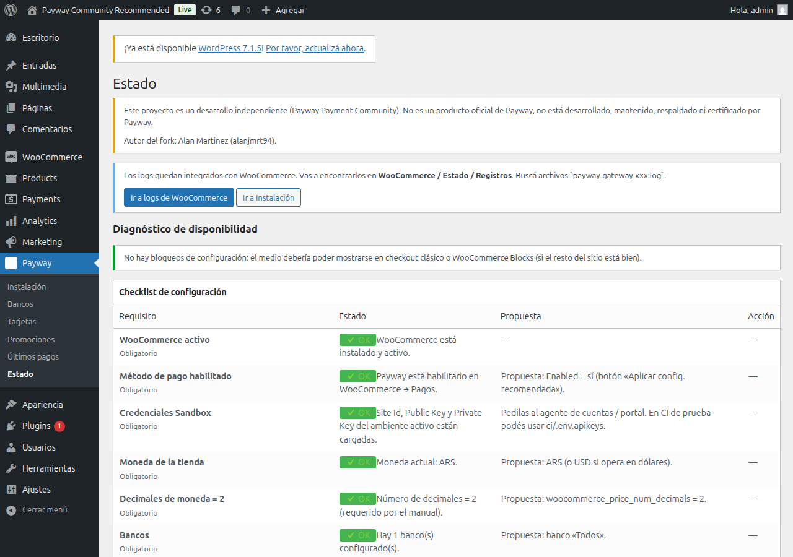
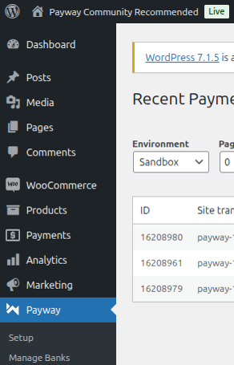

# 9. Diagnóstico, Status y Últimos pagos

Códigos internos (prefijo `PPC_`): ver `includes/class-wc-payway-errors.php`.

## Payway → Instalación

Checklist de lo obligatorio y recomendado (Enabled, keys, decimales, promos, Cybersource, etc.), con links de acción y seed de catálogo.

## Payway → Estado (Status)

Diagnóstico de disponibilidad del medio: gateway off, sin keys, sin promos aplicables, moneda, superficie de checkout (clásico **o** Blocks), versión plugin/SDK, etc.

## Payway → Últimos pagos (Recent Payments)

Lista pagos recientes vía API `PaymentList` usando la **Private Key** del ambiente activo (Sandbox o Producción según el gateway).

- Si faltan keys: aviso + link a la pantalla de Pagos / Instalación.
- Cuando hay meta `_payway_*` en el pedido, la fila puede enlazar al pedido WooCommerce.

## Errores frecuentes

| Síntoma | Causa probable | Acción |
|---|---|---|
| No aparece el medio | Gateway off / sin keys / sin promociones aplicables / Blocks sin API | Instalación + Pagos + Estado → Checkout surface |
| Notices rojos keys/promos | Enabled sin claves o sin promos aplicables | Completar Pagos + seed Instalación |
| Promo cargada pero no aparece | Vencida, día no aplicable o inactiva | Activar, días, o **Sin vencimiento** |
| Débito sin 1 cuota | Falta plan `fee_to_send=1` en la tarjeta débito | Promociones → planes |
| Error de token | Decidir JS no cargó | Consola del navegador, CSP, red, hosts frontend |
| `invalid payment_method_id` | `id_sps` de tarjeta incorrecto | Corregir tarjeta en admin |
| Auth / 401 | Keys inválidas o ambiente cruzado | Verificar Sandbox vs Producción |
| CS / Fraud Detection (ej. 10734) | Comercio exige Cybersource y está OFF, o datos bill_to incompletos | Activar CS; completar facturación; no “apagar CS” como fix genérico |
| CS Decision ROJO / REJECT | Antifraude o emisor; no necesariamente keys | Revisar Status tip CS; datos de facturación; emisor |
| Logs vacíos | Debug off | Activar Debug Mode solo para diagnóstico |

Logs: **WooCommerce → Estado → Registros** (`payway-gateway-*.log`). Los secretos se redactan. Con Debug **off**, el meta amplio `_payway_full_response` no se guarda.
